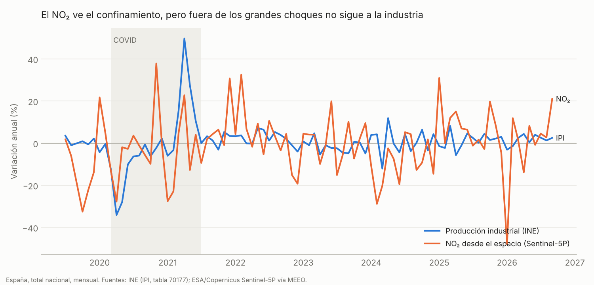

# PIB desde el espacio

¿Se puede medir la actividad económica de España desde el espacio, antes que las estadísticas oficiales y con datos gratuitos?

Este repositorio lo comprueba con datos reales y sin trampas. Cruza sensores de satélite y meteorología con las series del INE, entrena con el pasado y mide el acierto en meses que el modelo no ha visto. Si una fuente no aporta, se publica igual.

## Primer resultado: el NO₂ solo no basta



El NO₂ troposférico de Sentinel-5P capta el confinamiento de 2020. Fuera de los grandes choques no sigue a la producción industrial.

**Prueba:** estimar a final de cada mes la variación anual del Índice de Producción Industrial (IPI) de cada comunidad autónoma, que el INE publica unas seis semanas después. Se entrena con 2019–2022 y se evalúa con enero de 2023 a septiembre de 2026 (45 meses, 765 observaciones, 17 comunidades).

| Modelo | Error medio (puntos) | Mejora frente a la base | IC 95 % |
| --- | --- | --- | --- |
| Repetir el último IPI publicado | 6,64 | — | — |
| Base: IPI pasado + días laborables | 4,50 | 0 % | — |
| Base + NO₂ en bruto | 4,74 | −5,3 % | −14,2 % a +1,9 % |
| Base + NO₂ sin efecto del tiempo | 5,72 | −27,1 % | −42,9 % a −14,1 % |
| Base + NO₂ en bruto, entrenado sin COVID | 4,49 | +0,4 % | −0,5 % a +1,3 % |
| Base + NO₂ sin efecto del tiempo, entrenado sin COVID | 4,47 | +0,9 % | −1,0 % a +2,7 % |

El intervalo de confianza sale de un bootstrap por meses. La tabla completa está en [`resultados/comparativa_modelos.csv`](resultados/comparativa_modelos.csv).

**Lectura:**
- Entrenar con el confinamiento hace que el modelo exagere el peso del NO₂ y empeora la predicción después.
- Sin el confinamiento, la mejora es prácticamente cero y no es significativa.
- Quitar el efecto del tiempo (viento, radiación, lluvia, temperatura, humedad) no la rescata a escala de comunidad autónoma.
- Hay excepciones que apuntan al siguiente paso. La correlación entre NO₂ e IPI, fuera del COVID, es de 0,38 en Asturias (industria pesada concentrada) y 0,36 en Baleares. En el resto es cercana a cero. El NO₂ medio de una región mezcla tráfico, calefacción y fondo rural; la industria se diluye.

## Cómo funciona

1. **NO₂ diario por provincia** (`src/no2.py`). Lee los Cloud-Optimized GeoTIFF públicos de Sentinel-5P OFFL (bucket `meeo-s5p` en AWS) y descarga solo la ventana de España. Filtra con `qa_value ≥ 0,75` y promedia por provincia. Son 2.919 días entre julio de 2018 y octubre de 2026.
2. **Meteorología diaria por provincia** (`src/meteo.py`), de NASA POWER (MERRA-2): viento a 10 y 50 m, temperatura, humedad, lluvia, radiación y presión.
3. **Normalización meteorológica** (`src/backtest.py`). Un modelo de gradient boosting aprende, solo con datos anteriores a 2023 y sin el confinamiento, cuánto NO₂ cabe esperar dado el tiempo, la época del año y el día de la semana. La anomalía (observado frente a esperado) es la candidata a señal de actividad.
4. **Series oficiales** (`src/oficiales.py`), de la API del INE: IPI por comunidad autónoma (tabla 70177) y PIB trimestral (serie CNTR6654).
5. **Backtest** (`src/backtest.py`), con regresión ridge sobre el panel comunidad × mes. Solo usa información disponible al final de cada mes.

Todo usa fuentes públicas y sin claves. Un workflow de GitHub Actions actualiza datos y resultados cada lunes.

## Siguientes piezas del lego

- **NO₂ en focos puntuales.** Medir solo en los píxeles de grandes instalaciones (acerías, refinerías, cementeras, puertos) en vez de la media regional, que es donde aparece la señal.
- **Barcos en puertos con radar Sentinel-1.** Contar buques en Algeciras, Valencia, Barcelona o Bilbao como indicador de comercio.
- **Luces nocturnas** (NASA Black Marble). Requiere un token gratuito de Earthdata.
- **Objetivos más cercanos a cada sensor.** Pernoctaciones hoteleras para luces y NO₂ en zonas turísticas; producción por rama de actividad para focos industriales.

## Reproducir

```bash
pip install -r requirements.txt
python src/no2.py          # unos 10 minutos la primera vez
python src/meteo.py
python src/oficiales.py
cd src && python backtest.py && python grafico.py
```

## Fuentes

- ESA / Copernicus Sentinel-5P TROPOMI, NO₂ L2 OFFL, en formato COG de MEEO en AWS Open Data.
- NASA POWER (MERRA-2).
- INE: Índice de Producción Industrial (tabla 70177) y Contabilidad Nacional Trimestral (CNTR6654).
- Límites provinciales: codeforgermany/click_that_hood.
